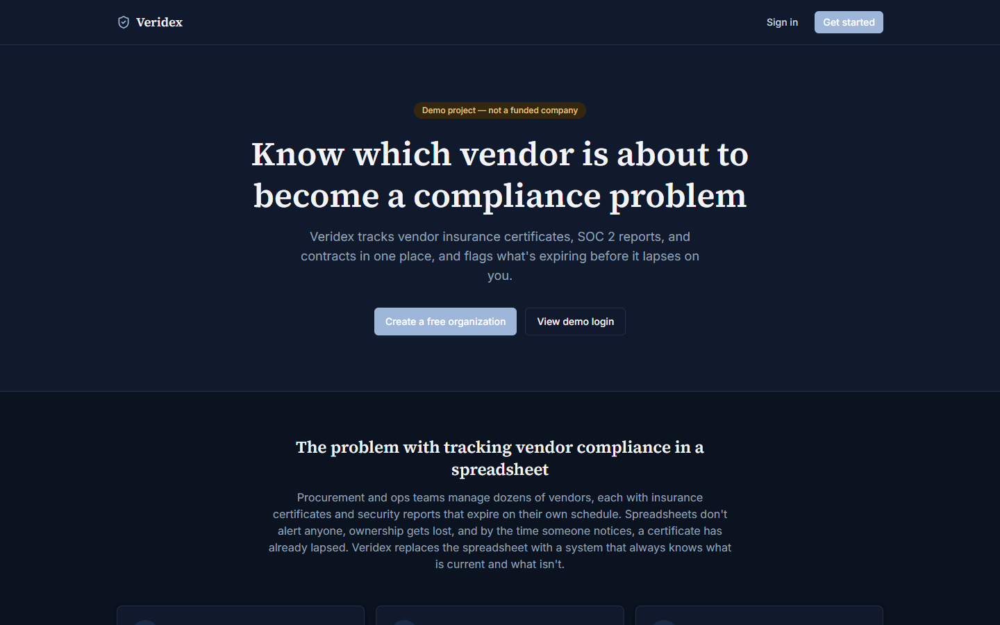

# Veridex

**A vendor compliance & risk-tracking SaaS — portfolio/demo project.**

> **This is a demo project, not a funded company.** It was built to demonstrate product and
> engineering work: a real Next.js + NestJS + PostgreSQL application, with a real (invented,
> disclosed) product concept behind it. There are no real customers, no real revenue, and no
> claimed certifications. See [docs/PROJECT_CONTEXT.md](docs/PROJECT_CONTEXT.md) for exactly what
> is invented and why, and [docs/LIMITATIONS.md](docs/LIMITATIONS.md) for what is not built.



*Public landing page, captured from the web app running locally. The authenticated dashboard and
vendor registry need the NestJS API and PostgreSQL running (see Quick start), so they are not pictured
yet.*

## The problem

Procurement and ops teams track dozens of vendors, each with insurance certificates, SOC 2
reports, and contracts that expire on their own schedule. Spreadsheets don't alert anyone,
ownership gets lost, and by the time someone notices, a certificate has already lapsed.

## The solution

Veridex is a multi-tenant web app where a team registers its vendors, uploads (metadata for)
their compliance documents, and gets:

- A **dashboard** with real, computed KPIs — vendor counts by status, a risk-band distribution
  chart, and a list of documents expiring soon or already expired.
- A **vendor registry** with search and status filtering.
- **Automatic document status** (`Valid` / `Expiring soon` / `Expired`) computed from the real
  expiration date on every read — never a stale cached flag.
- **Tenant isolation** enforced at the query layer — one organization cannot see another's data.

## Status

**Demo / working MVP.** Backend and frontend both build clean, pass their linters, and the
backend's unit test suite passes. The authenticated app was not verified against a live database
in this environment (see [docs/LIMITATIONS.md](docs/LIMITATIONS.md) for exactly why and what was
verified instead) — the public pages (landing, login, register) were checked in a real browser.

## Quick start

```bash
docker compose up -d postgres
cd api && cp .env.example .env && npm install && npm run db:migrate && npm run db:seed && npm run start:dev
cd web && npm install && npm run dev
```

Then open `http://localhost:3000` and sign in with `demo@veridex.app` / `demo-password-123` (see
[docs/DEMO.md](docs/DEMO.md) for a full walkthrough).

## Tech stack

| Layer | Technology |
|---|---|
| Frontend | Next.js 16 (App Router), TypeScript, Tailwind CSS v4, React Hook Form + Zod, TanStack Query, Recharts |
| Backend | NestJS 12, TypeScript (ESM), Prisma 7 (`@prisma/adapter-pg`), JWT auth (Passport) |
| Database | PostgreSQL 16 |
| Infra | Docker Compose, GitHub Actions CI |
| Testing | Vitest (backend unit tests) |

## Architecture, in one paragraph

Two services: a NestJS REST API that owns the database and enforces tenant isolation + auth, and
a Next.js frontend that acts as its own backend-for-frontend — Route Handlers proxy auth and
mutations so the browser never holds the raw JWT (it sits in an httpOnly cookie instead). Full
detail in [docs/ARCHITECTURE.md](docs/ARCHITECTURE.md).

## Project structure

```
saas-platform/
├── api/                  # NestJS backend
│   ├── prisma/           # schema.prisma, seed.ts
│   └── src/
│       ├── auth/          # register/login, JWT strategy & guard
│       ├── users/         # current-user profile, team listing
│       ├── vendors/       # vendor + document CRUD, tenant-scoped
│       ├── dashboard/     # computed KPI summary
│       ├── health/        # liveness/readiness
│       └── prisma/        # PrismaService (driver-adapter setup)
├── web/                  # Next.js frontend
│   └── src/
│       ├── app/
│       │   ├── (auth)/    # login, register — public
│       │   ├── (app)/     # dashboard, vendors, team, settings — authenticated
│       │   └── api/       # auth + proxy Route Handlers (BFF)
│       ├── components/    # ui/, shell/, vendors/, dashboard/
│       └── lib/           # api-client, api-server, session, types
├── docker-compose.yml
├── .github/workflows/ci.yml
└── docs/                 # see below
```

## Documentation

| Doc | Contents |
|---|---|
| [docs/PROJECT_CONTEXT.md](docs/PROJECT_CONTEXT.md) | Why this product concept was invented, and a full gap analysis against the (product-undefined) source dossier |
| [docs/PRODUCT_REQUIREMENTS.md](docs/PRODUCT_REQUIREMENTS.md) | Personas, functional/non-functional requirements, what's in vs. out of scope |
| [docs/ARCHITECTURE.md](docs/ARCHITECTURE.md) | System design and the reasoning behind it |
| [docs/USER_FLOWS.md](docs/USER_FLOWS.md) | Every flow, step by step, including failure paths |
| [docs/API_SPEC.md](docs/API_SPEC.md) | Endpoint reference (live docs at `/api/docs`) |
| [docs/DATA_MODEL.md](docs/DATA_MODEL.md) | Entities, relationships, deliberate simplifications |
| [docs/SECURITY.md](docs/SECURITY.md) | A real review: what was checked, found, and fixed |
| [docs/ROADMAP.md](docs/ROADMAP.md) | What's next and why it wasn't built now |
| [docs/DECISIONS.md](docs/DECISIONS.md) | Architecture decisions made during this build, with reasoning |
| [docs/UPGRADE-REPORT.md](docs/UPGRADE-REPORT.md) | Before/after of the post-launch quality pass (rate limiting, dialog accessibility, test coverage, UI depth) |
| [docs/DEMO.md](docs/DEMO.md) | How to run it, demo credentials, what's real vs. seeded |
| [docs/DEPLOYMENT.md](docs/DEPLOYMENT.md) | Docker Compose deployment, environment variables |
| [docs/TESTING.md](docs/TESTING.md) | What was tested, how, and what wasn't |
| [docs/LIMITATIONS.md](docs/LIMITATIONS.md) | Everything this build does not do, honestly |
| [CHANGELOG.md](CHANGELOG.md) | What changed in this build |

## Business & product overview

- **Problem**: vendor compliance tracking in spreadsheets loses ownership and misses expirations.
- **Target customer**: procurement/ops teams at mid-market companies managing dozens of vendors.
- **Differentiation**: automatic, always-correct document status computed from real dates, not a
  manually-updated flag; tenant-isolated multi-tenant architecture from day one.
- **Monetization (proposed, not implemented)**: seat- or vendor-count-based subscription, typical
  for this SaaS category.
- **Current stage**: demo/working MVP, not a funded company, no real customers.

## Portfolio case study

**What I built**: a full-stack, multi-tenant SaaS demo — NestJS API with real JWT auth, tenant
isolation, and a Postgres/Prisma data model; a Next.js frontend acting as its own BFF so the
access token never reaches client-side JavaScript; a distinct visual identity designed for the
product's domain rather than a default template.

**Approach**: since the source material defined no real product, I ran a gap analysis, invented
one disclosed demo concept to anchor real design decisions, then built backend-first (auth,
tenant-scoped data, a genuinely computed dashboard) before frontend polish, so every screen shows
real data flowing through a real API rather than static mockups.

**Key engineering decisions**: httpOnly-cookie BFF auth over localStorage tokens; document status
computed at read time instead of trusted from storage; Prisma 7's driver-adapter migration
(discovered and handled mid-build); dependency vulnerabilities found via `npm audit` and
actually fixed, not just logged.

**Challenges**: Docker Desktop could not be started in the sandboxed build environment, which
blocked live database verification — handled by validating the schema against the real Prisma
engine, building a full mocked-Prisma unit test suite, and being explicit in the docs about what
was and wasn't verified, rather than claiming untested code paths work.

**Current status**: Demo / working MVP — see [Status](#status) above.

**Limitations & roadmap**: [docs/LIMITATIONS.md](docs/LIMITATIONS.md) and
[docs/ROADMAP.md](docs/ROADMAP.md).

## License

Private/unlicensed demo project. Not intended for reuse as-is.
